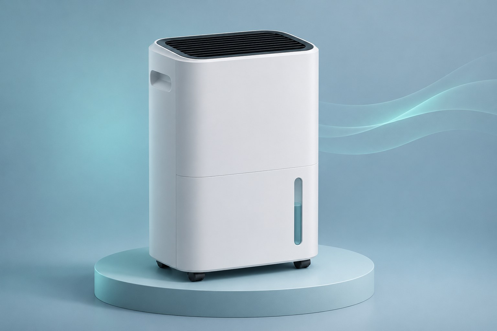

# Dreame DD20 para Home Assistant

Supervisa la humedad y el estado del deshumidificador Dreame DD20 desde Home Assistant. La integración consulta la nube de Dreamehome y expone **14 entidades de solo lectura** para paneles, historiales y automatizaciones basadas en el estado.

## Compatibilidad

| Requisito | Detalle |
| --- | --- |
| Deshumidificador | Dreame DD20, modelo `dreame.dehum.u2512` |
| Home Assistant | Core `2026.11.3` o posterior |
| Configuración | DD20 vinculado a una cuenta de Dreamehome |
| Conexión | Nube de Dreamehome mediante HTTPS, con sondeo cada 30 segundos por defecto |

La integración es comunitaria y se centra en la supervisión. El encendido, el cambio de modo y los demás ajustes se realizan desde Dreamehome o desde el panel del aparato. El acceso LAN y el estado del prefiltro están pendientes.

## Instalación con HACS

1. En **HACS**, abre el menú **⋮ → Repositorios personalizados**, añade `https://github.com/Carbanog/dreame_dehum` y selecciona el tipo **Integración**.
2. Busca **Dreame Dehumidifier**, descarga la versión de [Releases](https://github.com/Carbanog/dreame_dehum/releases) y reinicia Home Assistant.
3. Ve a **Ajustes → Dispositivos y servicios → Añadir integración** y elige **Dreame Dehumidifier**.
4. Introduce las credenciales en Home Assistant, selecciona la región de tu cuenta de Dreamehome y elige el DD20.

Si ya usas la versión de laboratorio desde `main`, selecciona la release desde **HACS → Dreame Dehumidifier → Volver a descargar** y reinicia. Conserva la entrada de integración para mantener las entidades existentes. El proyecto original comparte el dominio `dreame_dehum`, así que usa una sola variante por instalación.

## Entidades disponibles

| Grupo | Lecturas |
| --- | --- |
| Encendido | **Estado de encendido** (Apagado, Precalentando, Encendido) y sensor binario **Encendido** |
| Humedad | Humedad ambiente y consigna de humedad |
| Funcionamiento | Modo (Auto, Sueño, Secado de colada, Personalizado) y velocidad del ventilador |
| Opciones | Oscilación, plasma, bloqueo infantil y tono de tecla |
| Temporizador | Duración y estado activo |
| Secado | Secado de aire y ajuste de secado automático tras el apagado |

El sensor binario **Encendido** se activa desde el precalentamiento. Una transición corta puede ocurrir entre dos sondeos. La consigna se contrastó con Dreamehome en modo **Personalizado**.

## Ayuda y privacidad

- **El dispositivo no aparece.** Comprueba que el DD20 esté vinculado a Dreamehome, que uses la región de esa cuenta y que el modelo coincida.
- **Las lecturas tardan en actualizarse.** Espera al siguiente sondeo. El intervalo se puede ajustar en las opciones de la integración.
- **Home Assistant pide reautenticar.** Introduce de nuevo las credenciales desde el aviso de Home Assistant.

Home Assistant guarda las credenciales en la entrada de configuración. El diagnóstico de la integración solo incluye el modelo conocido y el estado del perfil. Para [informar de un problema](https://github.com/Carbanog/dreame_dehum/issues), indica la versión de Home Assistant, la versión de la integración y el comportamiento observado. Omite credenciales, capturas de cuenta e identificadores del dispositivo.

## Licencia y agradecimientos

Publicado bajo [licencia MIT](LICENSE). Deriva de [ha-dreame-dehum v0.1.7](https://github.com/vittorioallegra/ha-dreame-dehum/releases/tag/v0.1.7). Consulta [NOTICE](NOTICE) para ver las atribuciones.

Si el proyecto te resulta útil, puedes [apoyar su mantenimiento](https://buymeacoffee.com/Carbanog).
